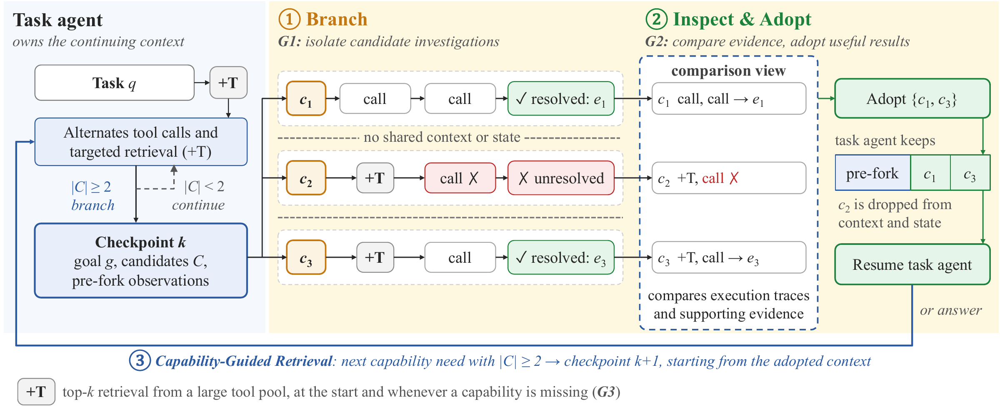

# BRIA: BRanch–Inspect–Adopt

Implementation of BRIA for retrieval-augmented tool use, described in
[Explore Separately, Adopt Selectively: Execution-Guided Tool Use over Large Tool Libraries](https://arxiv.org/abs/2610.22688).

BRIA investigates concrete candidates in isolated branches, inspects their
executed evidence, and adopts useful investigations before continuing the task.
The task agent and each branch can retrieve additional tools when a capability
is missing. Repeating an exact query retrieves tools that the requesting agent
has not already acquired.

## ⭐️ Overview



- **Branch:** investigate two or more candidates independently from the same
  pre-fork observations. Branches run sequentially and share task-wide budgets.
- **Inspect:** compare every candidate's executed calls, results, failures and
  cited evidence. Evidence ownership and exact stored values are checked
  mechanically; semantic relevance remains the task agent's responsibility.
- **Adopt:** retain an ordered subset of candidate processes, including none or
  several. Future context, evidence permissions, acquired schemas and execution
  lineage retain only the selected branches. All investigation costs remain spent.
- **Retrieve:** start with task-text retrieval and acquire missing capabilities
  incrementally over one shared public-schema index. Search memory is local to
  each agent; only selected branch memories join the task agent.

The package includes BRIA, dense retrieval, public-schema ingestion, and adapters
for separately obtained PlanBench-XL and MCP-Atlas environments. The benchmark
adapters implement the read-only execution profile. Code execution and mutable
file workspaces require a separate isolated runtime.

## 📂 Codebase

Start with [agent.py](src/bria/agent.py) to follow the method. Its main loop opens candidate
branches, compares their evidence, adopts the selected branches, and continues.
Prompts and context construction are in [prompts.py](src/bria/prompts.py).

```text
bria.yaml                Method budgets and embedding settings
src/bria/
  agent.py               BRIA's branch, inspect, adopt, and retrieval actions
  prompts.py             Task-agent and branch prompts and context construction
  state.py               Task/tool types, budgets, and scoped evidence storage
  retrieval.py           Qwen encoder, vector index, and tool retrieval
  corpus.py              Public-schema ingestion from external benchmarks
  benchmarks.py          PlanBench-XL and MCP-Atlas execution and evaluation
  run.py                 Model API client and command-line interface
```

| ID | OSS component | Copyright holder | Source | License |
| --- | --- | --- | --- | --- |
| 1 | BRIA | Megagon Labs, Inc. | This repository | [BSD-3-Clause](LICENSE) |

## 🛠️ Installation

Use Python 3.10 or newer; Python 3.11 is a suitable choice for the optional model
dependencies. From this repository:

```bash
python -m venv .venv
source .venv/bin/activate
python -m pip install -e '.[qwen,mcp-data]'
```

For the core API without local embedding-model inference or Parquet loading:

```bash
python -m pip install -e .
```

Exact inner-product retrieval uses NumPy. The optional `faiss` extra enables
FAISS acceleration with the same deterministic tie-breaking. Qwen model weights
are downloaded from their original source when the embedding model is first used.

## 💿 Datasets and external resources

Obtain datasets directly from their original publishers and keep them outside
this repository. Dataset contents, tool-schema snapshots, embeddings, indexes,
model weights, predictions and execution records are not part of this source
distribution. The links below identify the upstream resources and their declared
licenses.

| ID | Dataset | Publisher | Original source | License |
| --- | --- | --- | --- | --- |
| 1 | PlanBench-XL | PlanBench-XL authors | [Dataset](https://huggingface.co/datasets/JiayuJeff/PlanBench-XL), [benchmark environment](https://github.com/JiayuJeff/PlanBench-XL) | [MIT, as declared by the dataset card](https://huggingface.co/datasets/JiayuJeff/PlanBench-XL#dataset-card) |
| 2 | MCP-Atlas | Scale AI | [Dataset](https://huggingface.co/datasets/ScaleAI/MCP-Atlas), [benchmark environment](https://github.com/scaleapi/mcp-atlas) | [CC-BY-4.0 for the dataset](https://huggingface.co/datasets/ScaleAI/MCP-Atlas#license); [MIT for the environment](https://github.com/scaleapi/mcp-atlas/blob/main/LICENSE) |

PlanBench-XL's executable tools require the full upstream environment, including
`src/env/` and `src/data/`. Its Hugging Face query file alone is insufficient for
execution. The dataset-card license is a dataset declaration; consult the upstream
project for terms governing its runtime source. No benchmark runtime source is
vendored here.

| External model | Publisher | Original source | License |
| --- | --- | --- | --- |
| Qwen3-Embedding-8B | Qwen team | [Model and model card](https://huggingface.co/Qwen/Qwen3-Embedding-8B) | [Apache-2.0](https://huggingface.co/Qwen/Qwen3-Embedding-8B/blob/main/LICENSE) |

Pin the upstream benchmark revisions, model revision and schema snapshot when
comparing runs. The number of tools depends on the supplied environment and its
reviewed schemas. This package's read-only profile does not reproduce the paper's
execution-enabled catalog by itself.

## 🔎 Prepare the shared tool index

Choose an external working directory and acquire the upstream environments:

```bash
export BRIA_WORKDIR=/absolute/path/to/bria-work
mkdir -p "$BRIA_WORKDIR"
git clone https://github.com/JiayuJeff/PlanBench-XL "$BRIA_WORKDIR/PlanBench-XL"
git clone https://github.com/scaleapi/mcp-atlas "$BRIA_WORKDIR/mcp-atlas"
export PLANBENCH_ROOT="$BRIA_WORKDIR/PlanBench-XL"
export MCP_ATLAS_ROOT="$BRIA_WORKDIR/mcp-atlas"
```

Download `MCP-Atlas.parquet` from the dataset link above into the external working
directory. Install each upstream environment's own dependencies and follow the
[MCP-Atlas setup instructions](https://github.com/scaleapi/mcp-atlas#quick-start)
to start its agent-environment API. BRIA connects to that API directly.
Set `SANDBOX_AUTH_TOKEN` to the same token configured for your MCP environment;
the client sends it as a bearer token. Use your chosen URL for `MCP_URL`:

```bash
export MCP_URL=http://localhost:1984
bria build-corpus \
  --planbench-root "$PLANBENCH_ROOT" \
  --mcp-url "$MCP_URL" \
  --output-dir "$BRIA_WORKDIR/corpus"

bria build-index \
  --config bria.yaml \
  --corpus "$BRIA_WORKDIR/corpus/union_tools.jsonl" \
  --corpus-manifest "$BRIA_WORKDIR/corpus/manifest.json" \
  --output-dir "$BRIA_WORKDIR/index"
```

To ingest an existing external schema snapshot offline, replace `--mcp-url` with
`--mcp-schema-snapshot /path/to/schemas.json --mcp-servers server-a,server-b`.
Snapshots contain a JSON array of public MCP tool schemas. Explicit `server`
metadata on each schema can replace the server-name option. Use `--device cuda:0`
or `--device cuda:0,cuda:1` on `build-index` to select encoding devices, and keep
the run configuration's `embedding.device` consistent with the intended query
encoder placement.

Corpus and index manifests verify source checksums, document formatting, model
revision and query instruction. Outputs require a fresh directory.

## 🚀 Run BRIA

Configure an OpenAI-compatible Chat Completions endpoint with `LLM_API_KEY` and
`LLM_BASE_URL`. Set `BRIA_MODEL` to your provider's model identifier. Generation
options include `--max-output-tokens`, `--temperature`, `--reasoning-effort` and
`--timeout`; choose values supported by your provider.

Every solver request sends `response_format={"type":"json_object"}`. Pass exactly
one `--response-format json_object` in each run command. The transport makes one
provider request per attempt and preserves unknown tool outcomes for review.

Before executing MCP tools, supply an external, host-reviewed execution contract.
Review the actual tool effects and confirm that cache reads are disabled; tool
names or read-only hints alone are insufficient. Bind the permitted tools to
their `public_schema_hash` values from the generated corpus:

```json
{
  "contract_id": "reviewed-read-only-tools",
  "cache_policy": "disabled",
  "environment_epoch": "your-environment-identity",
  "non_mutating_schema_hashes": ["<exact-public-schema-hash>"]
}
```

Save this file outside the repository, for example as
`$BRIA_WORKDIR/execution_contract.json`. Only reviewed MCP schemas can execute.
The MCP adapter sets `use_cache=false` on tool calls. The PlanBench adapter uses
the upstream native executor and enforces its private input and provenance gates
against the current branch lineage.

Both benchmark commands accept the same cohort options:

- `--cohort 75tasks` selects the fixed 75-task subset for the benchmark.
  The repository ships [the task IDs in their original order](src/bria/75tasks.json).
  BRIA checks that every ID exists in the supplied dataset before starting the run.
- `--cohort full` selects every task in the supplied dataset in dataset order.
  Use the complete upstream dataset for a full benchmark run (327 PlanBench-XL
  tasks or 500 MCP-Atlas tasks). The full benchmark includes the fixed 75-task subset.

To preview the task IDs, use `list-tasks` with the same cohort option:

```bash
bria list-tasks --benchmark planbench_xl --cohort 75tasks \
  --dataset "$PLANBENCH_ROOT/src/data/retail/queries.json"
bria list-tasks --benchmark mcp_atlas --cohort 75tasks \
  --dataset "$BRIA_WORKDIR/MCP-Atlas.parquet"
```

Run PlanBench-XL:

```bash
bria run-planbench \
  --config bria.yaml \
  --corpus "$BRIA_WORKDIR/corpus/union_tools.jsonl" \
  --corpus-manifest "$BRIA_WORKDIR/corpus/manifest.json" \
  --index-dir "$BRIA_WORKDIR/index" \
  --planbench-root "$PLANBENCH_ROOT" \
  --dataset "$PLANBENCH_ROOT/src/data/retail/queries.json" \
  --mcp-url "$MCP_URL" \
  --execution-contract "$BRIA_WORKDIR/execution_contract.json" \
  --model "$BRIA_MODEL" --response-format json_object \
  --cohort 75tasks \
  --output-dir "$BRIA_WORKDIR/runs/planbench-75tasks"
```

For MCP-Atlas, use `bria run-mcp-atlas` with the same corpus, index, environment
and model arguments, `--dataset "$BRIA_WORKDIR/MCP-Atlas.parquet"`,
`--cohort 75tasks` and a separate output directory. For either benchmark, switch to
`--cohort full` and choose a fresh output directory to run all tasks. For a
custom selection, omit `--cohort` and use one or more `--task-id` flags or an
external `--task-list` file with one ID per line. Tasks and candidate branches
execute sequentially.

Each run writes its resolved configuration, task results and evidence records to
the chosen external output directory. `predictions.csv` contains `task_id` and
`response` columns for independent evaluation. An incomplete task stops the run
with its saved status; it is not silently counted as a successful answer or retried.

## 📊 Evaluation

Evaluate completed PlanBench predictions separately from the solver:

```bash
bria score-planbench \
  --planbench-root "$PLANBENCH_ROOT" \
  --dataset "$PLANBENCH_ROOT/src/data/retail/queries.json" \
  --run-dir "$BRIA_WORKDIR/runs/planbench-75tasks" \
  --output-dir "$BRIA_WORKDIR/scores/planbench"
```

This reports native answer, trusted-target and final-answer provenance checks
over the pre-fork executions and adopted branch lineages. Answer correctness and
native success are recorded separately.

For MCP-Atlas, use the separately obtained
[official claim scorer](https://github.com/scaleapi/mcp-atlas/tree/main/services/scoring)
with BRIA's `predictions.csv` and the corresponding external ground-truth CSV.
Configure the judge's model, endpoint and credentials independently from the solver,
and retain its strict JSON-schema response contract. Ground-truth claims,
trajectories, native hidden datatypes and scores are excluded from solver and
retrieval inputs.

## 📚 Citation

```bibtex
@article{mazhar2026explore,
  title={Explore Separately, Adopt Selectively: Execution-Guided Tool Use over Large Tool Libraries},
  author={Mazhar, Anna and Maekawa, Seiji and Bhutani, Nikita},
  journal={arXiv preprint arXiv:2610.22688},
  year={2026},
  url={https://arxiv.org/abs/2610.22688}
}
```

## 📜 Disclosure
Embedded in, or bundled with, this product are open source software (OSS) components, datasets and other third party components identified below. The license terms respectively governing the datasets and third-party components continue to govern those portions, and you agree to those license terms, which, when applicable, specifically limit any distribution. You may receive a copy of, distribute and/or modify any open source code for the OSS component under the terms of their respective licenses, which may be BSD 3 clause license and Apache 2.0 license. In the event of conflicts between Megagon Labs, Inc., license conditions and the Open Source Software license conditions, the Open Source Software conditions shall prevail with respect to the Open Source Software portions of the software. 
You agree not to, and are not permitted to, distribute actual datasets used with the OSS components listed below. You agree and are limited to distribute only links to datasets from known sources by listing them in the datasets overview table below. You are permitted to distribute derived datasets of data sets from known sources by including links to original dataset source in the datasets overview table below. You agree that any right to modify datasets originating from parties other than Megagon Labs, Inc. are governed by the respective third party’s license conditions. 
All OSS components and datasets are distributed WITHOUT ANY WARRANTY, without even implied warranty such as for MERCHANTABILITY or FITNESS FOR A PARTICULAR PURPOSE, and without any liability to or claim against any Megagon Labs, Inc. entity other than as explicitly documented in this README document. You agree to cease using any part of the provided materials if you do not agree with the terms or the lack of any warranty herein.
While Megagon Labs, Inc., makes commercially reasonable efforts to ensure that citations in this document are complete and accurate, errors may occur. If you see any error or omission, please help us improve this document by sending information to contact_oss@megagon.ai.
